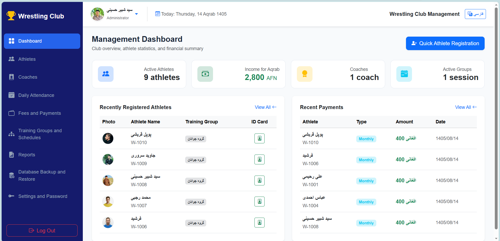
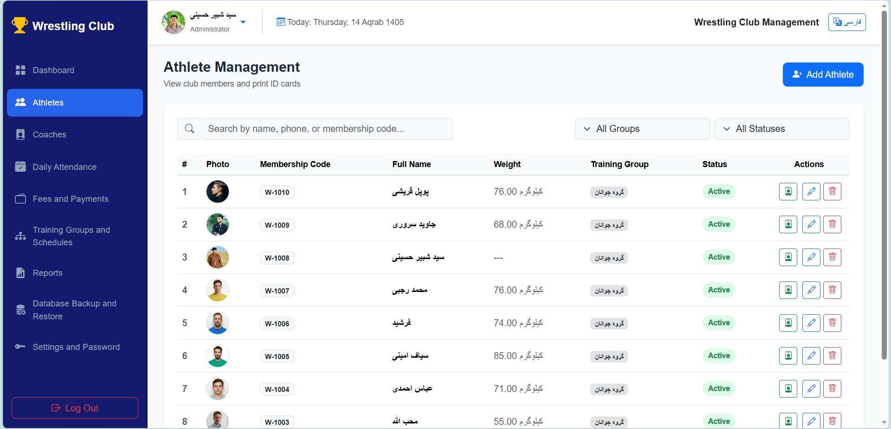
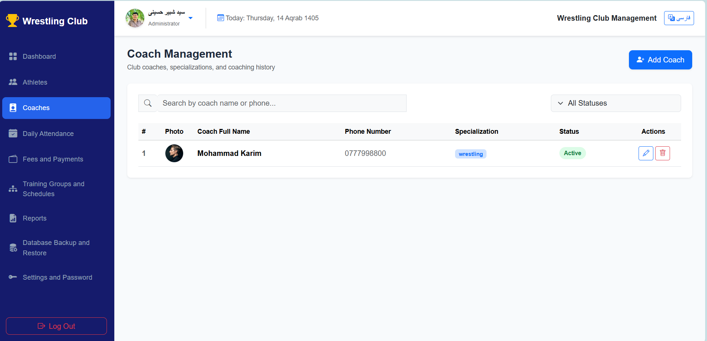
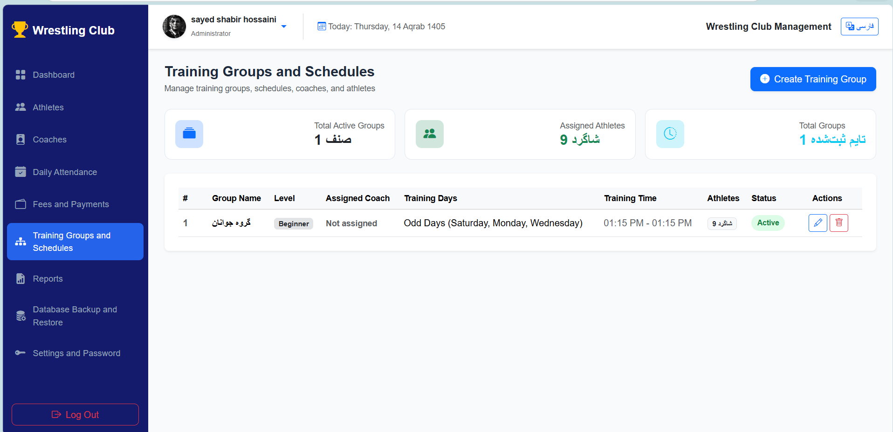
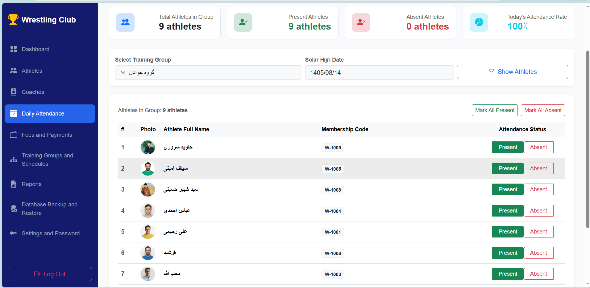
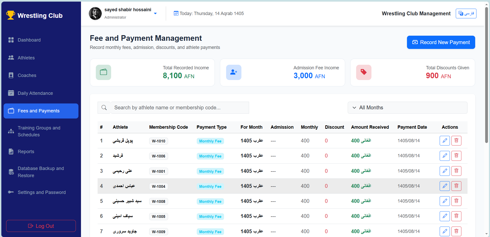
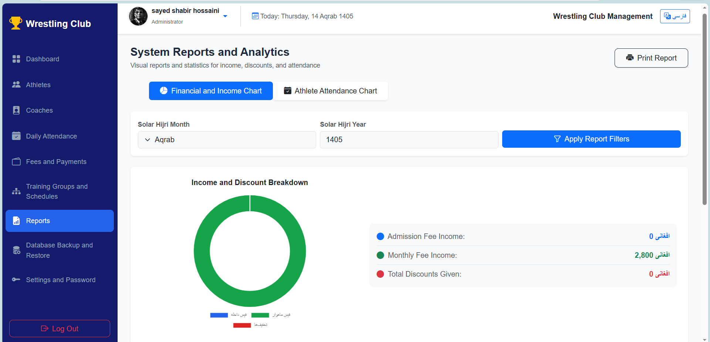
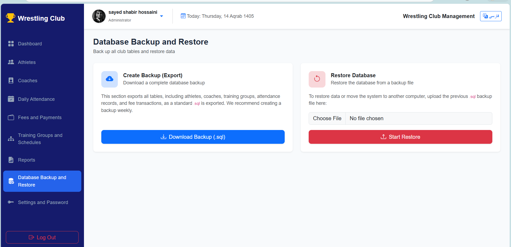
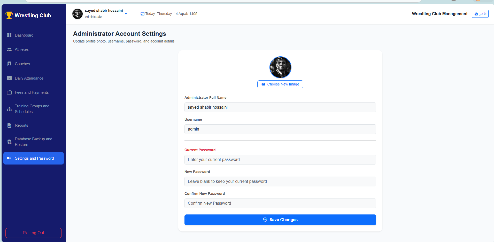

# 🥋 Wrestling Club Management System

**An Offline-First Management System for Wrestling Clubs**

A complete and user-friendly management system designed to simplify the daily operations of wrestling clubs. The system provides tools for managing athletes, coaches, training groups, attendance, membership fees, financial records, and reports — all through a modern, responsive, and fully offline interface.

Built specifically for local deployment, this system runs on a local computer using XAMPP without requiring an internet connection or cloud server.

---

## 📌 Project Overview

The Wrestling Club Management System is designed to replace traditional paper-based management processes with a centralized digital solution.

It helps club administrators manage athletes, organize training schedules, monitor attendance, track payments, and generate professional reports from one centralized dashboard.

The system follows an **Offline-First Architecture**, making it suitable for wrestling clubs and local sports organizations with limited or no internet access.

---

## ✨ Key Features

### 1. 🔐 Authentication & Security

- Secure login system with username and password.
- Password hashing using PHP `password_hash()` and `password_verify()`.
- Session-based authentication.
- Role-based access control.
- User profile management.
- Profile picture upload.
- Password and username management.
- Secure logout functionality.

### 2. 📊 Dashboard & Statistics

- Total number of athletes.
- Active and inactive members.
- Total number of coaches.
- Daily attendance statistics.
- Monthly income and payment statistics.
- Interactive charts using Chart.js.
- Visual overview of club activities.

### 3. 🥋 Athlete Management

- Register new athletes.
- Store personal and contact information.
- Record athletic information, including weight, height, and weight category.
- Upload athlete profile pictures.
- Assign athletes to training groups and schedules.
- View individual athlete profiles.
- Track attendance and payment history.
- Print athlete membership cards.
- Activate, deactivate, or remove athlete records.
- Search, filter, and paginate athlete lists.

### 4. 👨‍🏫 Coach Management

- Add and manage coaches.
- Store contact information and professional specialties.
- Manage coach profiles.
- Assign coaches to training groups.
- Activate or deactivate coaches.

### 5. 🏋️ Training Groups & Schedules

- Create and manage training groups.
- Define different skill levels:
  - Beginner
  - Intermediate
  - Advanced
- Configure weekly training days.
- Set training start and end times.
- Assign responsible coaches to each group.

### 6. 📅 Attendance Management

- Record daily athlete attendance.
- Select training groups and dates.
- Mark athletes as Present or Absent.
- Quick group-based attendance registration.
- View historical attendance records.
- Track individual athlete attendance history.
- Support for the Solar Hijri calendar.

### 7. 💰 Financial & Payment Management

- Record new athlete payments.
- Support Afghan Afghani (AFN).
- Manage different payment types:
  - Registration Fee
  - Monthly Membership Fee
  - Combined Payments
- Apply discounts.
- Add payment descriptions and receipt numbers.
- Identify athletes with unpaid monthly fees.
- View complete payment history.
- Filter financial transactions by month and year.

### 8. 📑 Reports & Printing

- Athlete registration reports.
- Reports based on training groups and weight categories.
- Active and inactive athlete reports.
- Monthly and yearly financial reports.
- Attendance and absence reports.
- Print-friendly report layouts.

### 9. 💾 Backup & Restore

- Download database backups in `.sql` format.
- Restore database information from backup files.
- Protect important club records against accidental data loss.

### 10. 🎨 UI & General Features

- Fully Right-to-Left (RTL) interface.
- Persian/Dari language support.
- Responsive interface using Bootstrap.
- Solar Hijri calendar integration using `jdf.php`.
- Interactive charts using Chart.js.
- Offline-first functionality.
- Local database management using MySQL.
- Designed for local deployment through XAMPP.

---

## 🛠️ Technologies Used

| Technology | Purpose                    |
| ---------- | -------------------------- |
| PHP        | Backend Development        |
| MySQL      | Database Management        |
| PDO        | Database Connectivity      |
| HTML5      | Page Structure             |
| CSS3       | Styling                    |
| JavaScript | Interactive Functionality  |
| Bootstrap  | Responsive UI & RTL Layout |
| Chart.js   | Data Visualization         |
| JDF        | Solar Hijri Calendar       |
| XAMPP      | Local Development Server   |

---

## ⚙️ Installation & Setup

Follow these steps to run the project locally.

### Prerequisites

Make sure you have installed:

- XAMPP
- PHP 8.x
- MySQL
- A modern web browser

### Step 1: Clone the Repository

```bash
git clone https://github.com/DevShabir/wrestling-club-management.git
```

### Step 2: Move the Project

Move the project folder into the XAMPP `htdocs` directory.

Example:

```text
C:/xampp/htdocs/wrestling-club-management
```

### Step 3: Start XAMPP

Open XAMPP Control Panel and start:

- Apache
- MySQL

### Step 4: Create the Database

1. Open phpMyAdmin.
2. Create a new MySQL database.
3. Import the provided database `.sql` file, if included.

### Step 5: Configure Database Connection

Update your database configuration file with your local MySQL credentials.

Example:

```php
$host = "localhost";
$dbname = "wrestling club management system";
$username = "root";
$password = "";
```

### Step 6: Run the Project

Open your browser and visit:

```text
http://localhost/wrestling-club-management/
```

The system should now be accessible locally.

---

## 🖥️ System Architecture

**Architecture:** Offline-First Modular Monolith

The system is organized into separate functional modules while sharing a centralized database.

Main modules:

- Authentication
- Dashboard
- Athletes
- Coaches
- Training Groups
- Attendance
- Payments
- Reports
- Backup & Restore

This architecture keeps the system organized, maintainable, and suitable for future improvements.

---

## 📸 Screenshots

### Dashboard


### Athlete Management


### Coach Management


### Training Schedules


### Attendance Management


### Financial Management


### Reports


### Backup & Restore


### System Settings


## 🎯 Project Goals

The main goals of this project are:

- Digitizing wrestling club management.
- Reducing manual paperwork.
- Improving athlete record management.
- Simplifying attendance tracking.
- Improving financial transparency.
- Providing reliable local data management.
- Offering an affordable solution for local sports clubs.

---

## 🔮 Future Improvements

Possible future enhancements include:

- Multiple club support.
- Advanced user roles and permissions.
- Automated payment reminders.
- More advanced analytical reports.
- Cloud synchronization.
- Mobile application integration.

---

## 👨‍💻 Developer

Developed as a practical software development project focused on building a real-world management solution for local wrestling clubs.

**Project:** Wrestling Club Management System
**Version:** 1.0.0
**Architecture:** Offline-First Modular Monolith
**Platform:** Windows / Local Server

---

## 📄 License

**Copyright (c) 2026 Sayed Shabir Hossaini**

All rights reserved.

Permission is hereby granted, free of charge, to any person obtaining a copy of this software and associated documentation files (the "Software"), to view the code for educational and portfolio purposes only.

However, you are NOT permitted to:

1. Use, modify, copy, or distribute this software for commercial purposes.
2. Sell or sublicense the software to third parties.

THE SOFTWARE IS PROVIDED "AS IS", WITHOUT WARRANTY OF ANY KIND, EXPRESS OR IMPLIED, INCLUDING BUT NOT LIMITED TO THE WARRANTIES OF MERCHANTABILITY, FITNESS FOR A PARTICULAR PURPOSE AND NONINFRINGEMENT. IN NO EVENT SHALL THE AUTHORS OR COPYRIGHT HOLDERS BE LIABLE FOR ANY CLAIM, DAMAGES OR OTHER LIABILITY, WHETHER IN AN ACTION OF CONTRACT, TORT OR OTHERWISE, ARISING FROM, OUT OF OR IN CONNECTION WITH THE SOFTWARE OR THE USE OR OTHER DEALINGS IN THE SOFTWARE.
